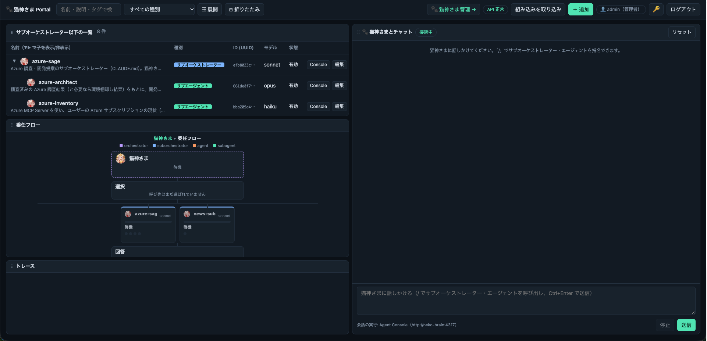
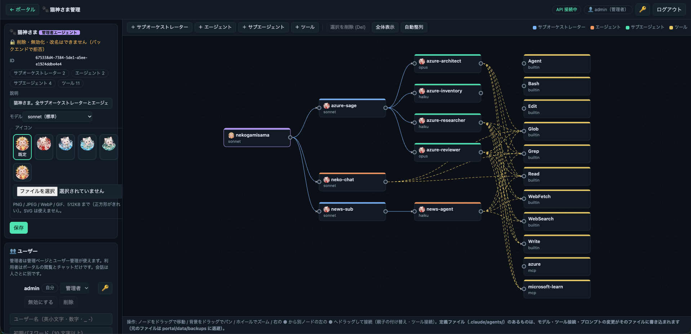
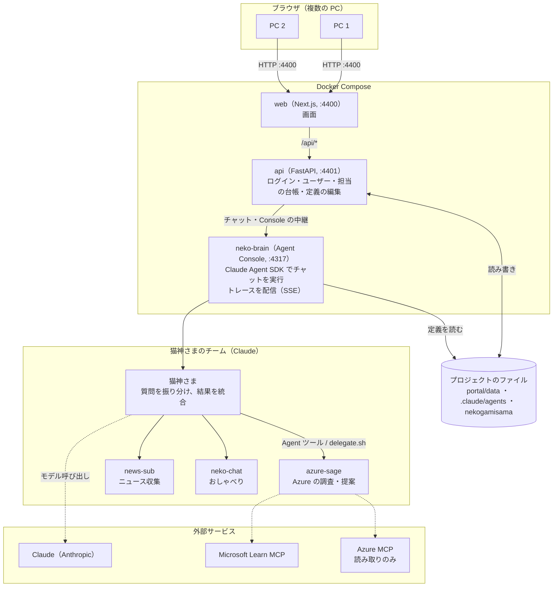
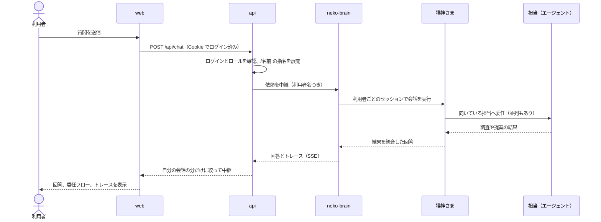

# 猫神さま（NekoGamiSama）

<p align="center"></p>

**猫神さま**は、複数のエージェントを束ねて、質問に答えてくれる指揮役です。
質問を読み、いちばん向いている担当（エージェント）に依頼し、返ってきた結果をまとめて、日本語で答えます。
[Claude Code](https://docs.claude.com/en/docs/claude-code) の上で動き、ブラウザの画面から、チャットで話しかけたり、担当の関係や動きを見たりできます。

見た目は若い女性ですが、実は歳を経て猫神になった猫又の化け猫です。「わし」「〜じゃ」という老猫のような口調で話します（口調は管理ページで変えられます）。

## できること

- **質問を担当に振り分ける**: 猫神さまが質問を分類して、担当に依頼します。複数の担当にまたがるときは、依頼を分けて並列に進め、最後に統合します。
- **担当を指名する**: チャットで `/名前 依頼文` と書くと、その担当へ直接依頼できます。
- **動きが見える**: 誰が呼ばれたか（委任フロー）、ツールの呼び出しなどがリアルタイムに表示されます。
- **担当を足せる**: 管理ページのノードグラフで、サブオーケストレーター・エージェント・ツールを追加し、つなぎ替えられます。
- **複数人で使える**: ログインと、管理者／利用者のロールがあります。会話は人ごとに別です。

### 最初から入っている担当

| 担当 | 役割 |
|---|---|
| `azure-sage` | Azure 全般（Microsoft Foundry / Agent 365 を含む）の調査・精査・開発提案。調査は軽量モデル、精査と提案は Opus で分担します |
| `news-sub` | 日経や海外のニュース（AI 関連）の収集 |
| `neko-chat` | おしゃべり担当。あいさつ・雑談・使い方の説明 |

担当は `.claude/agents/` の定義ファイルで決まります。自分用の担当に入れ替えて使えます。

## 画面

| ポータル `/` | 猫神さま管理 `/admin` |
|---|---|
|  |  |
| 担当の一覧、委任フロー、トレース、猫神さまとのチャット | ノードグラフで担当・ツールを追加・接続。テーマ・性格・ユーザーの設定 |

画面は 3 つです。ポータル `/`、猫神さま管理 `/admin`（管理者のみ）、Agent Console `/console`（管理者のみ。Claude のログインと、トレース・ドキュメントの確認ができます）。

## 仕組み

3 つのコンテナで動きます。ブラウザが開くのは `web` だけで、`api` と `neko-brain` はコンテナの中のネットワークにだけ出ています。



| コンテナ | 役割 |
|---|---|
| `web` | 画面（Next.js）。ポータル、猫神さま管理、Agent Console |
| `api` | ログインとロールの判定、ユーザー管理、担当の台帳、定義ファイルの編集、テーマ・性格。チャットは `neko-brain` に中継します |
| `neko-brain` | 猫神さまの脳。Claude を実行し、トレースを配信します。認証は持たず、`api` の背後にだけ置きます |

### 質問が答えになるまで



- 会話は **利用者ごと** に別のセッションです。他の人の会話やトレースは流れてきません。
- 猫神さまの結果の統合は、**結論 → 根拠 → 未確定事項 → 出典** の順で、日本語で返されます。
- 担当は `.claude/agents/` の定義ファイルと、`nekogamisama/suborchestrators.json` の委任先一覧で決まります。管理ページの変更は、これらのファイルに書き込まれ、`neko-brain` にも反映されます。

## クイックスタート（Docker）

### 必要なもの

- Docker と Docker Compose
- Claude の認証: Claude のアカウント（サブスクリプション）か、Anthropic の API キー（従量課金）
- Azure の調査をさせる場合のみ: Azure のサービスプリンシパル（**閲覧者 Reader ロール**を推奨）

### 手順

```bash
git clone https://github.com/manyanxp/nekogami.git
cd nekogami

# 1. 設定ファイルを作る（最初の管理者と、公開範囲）
cat > .env <<'EOF'
PORTAL_ADMIN_USER=admin
PORTAL_ADMIN_PASSWORD=ここに10文字以上のパスワード
# 他の PC からも使うときは次の行を有効にする（既定は自分の PC だけ）
# BIND_ADDR=0.0.0.0
# API キーで認証するときは次の行を有効にする
# ANTHROPIC_API_KEY=sk-ant-...
EOF

# 2. 起動する（初回はビルドに数分かかります）
docker compose up -d --build

# 3. Claude にログインする（API キーを使うなら不要）
docker compose exec neko-brain claude      # 開いたら /login
```

ブラウザで **http://127.0.0.1:4400** を開き、`.env` に書いた管理者でログインします。ログインできたら、ユーザーのカードでパスワードを変え、`.env` の `PORTAL_ADMIN_PASSWORD` の行は消して構いません（最初のユーザーを作るためだけに使います）。

> Claude のログインは、管理者で `/console` を開いて、画面からも行えます。ログイン状態は Docker のボリューム（`claude-config`）に残ります。

### 停止・更新

```bash
docker compose down                       # 停止
git pull && docker compose up -d --build  # 更新
```

## 複数の PC から使う

1. `.env` に `BIND_ADDR=0.0.0.0` を書いて、`docker compose up -d` で起動し直します。
2. 他の PC のブラウザで `http://<このマシンの IP>:4400` を開き、ログインします。
3. つながらないときは、ファイアウォールで TCP 4400 の受信を許可します（WSL2 の Mirrored 構成では、Windows 側のファイアウォールです）。

> **注意**: 通信は HTTP のままで、パスワードと Cookie は暗号化されません。信頼できる LAN の中だけで使うか、前に TLS のリバースプロキシ（Caddy や nginx など）を置いてください。インターネットには公開しないでください。

### ユーザーとロール

| できること | 管理者 | 利用者 |
|---|---|---|
| ポータルの閲覧、猫神さまとのチャット | ○ | ○（会話は自分の分だけ） |
| 自分のパスワード変更 | ○ | ○ |
| 担当・ツール・性格・テーマの変更、管理ページ、Agent Console、ユーザー管理 | ○ | × |

ユーザーは、管理ページの「ユーザー」カードで追加・無効化・削除できます。コマンドでもできます。

```bash
docker compose exec api python -m portal_api users add 名前 --role user   # 追加（パスワードを聞かれます）
docker compose exec api python -m portal_api users list
```

## 使い方

- **チャット**: ポータル右の欄に話しかけます。`/` を打つと、担当の候補が出ます。送信は `Ctrl+Enter` です。
  - 例: `猫神さま、今日は何ができるのじゃ？`
  - 例: `/azure-sage Microsoft Foundry の料金体系を調べて`
- **担当を足す**: 管理ページ `/admin` で「＋ エージェント」などを選びます。ノードをドラッグしてつなぎ替えます。変更は `.claude/agents/` の定義ファイルに書き込まれます（元のファイルは `portal/data/backups` に退避されます）。
- **口調を変える**: 管理ページの「猫神さまの性格」で、一人称や口調を設定します。
- **色を変える**: 管理ページの「テーマ」で、モード（ダーク／ライト）とアクセント色を設定します。
- **ターミナルで話す**: `cd nekogamisama && claude`（Claude Code が必要です）。

## 設定

`.env` に書きます（`docker compose` が読み込みます）。

| 変数 | 内容 | 既定 |
|---|---|---|
| `PORTAL_ADMIN_USER` / `PORTAL_ADMIN_PASSWORD` | 最初の管理者。ユーザーが 1 人もいないときだけ使われます | なし |
| `BIND_ADDR` | 画面の公開先。`0.0.0.0` で他の PC からも使える | `127.0.0.1` |
| `WEB_PORT` | 画面のポート | `4400` |
| `ANTHROPIC_API_KEY` / `CLAUDE_CODE_OAUTH_TOKEN` | Claude の認証（`claude` でログインするなら不要） | なし |
| `CHAT_MODEL` | チャットで使うモデル（例: `opus`） | `.claude/settings.json` |
| `ALLOW_AZURE_MCP` | `0` で Azure MCP を使わない | 有効 |
| `AZURE_TENANT_ID` / `AZURE_CLIENT_ID` / `AZURE_CLIENT_SECRET` | Azure を見るときのサービスプリンシパル（Reader 推奨） | なし |
| `NYA_SUFFIX` | トレースのエージェント発言の語尾（空で無効） | `にゃ` |
| `PORTAL_AUTH` | `0` でログインを無効にする（自分だけで使うとき。全員が管理者になります） | 有効 |
| `PORTAL_TOKEN` | スクリプトから API を叩くための Bearer トークン（管理者扱い） | なし |

## 安全のために

- **Azure は読み取りだけ**: 猫神さまは Azure のリソースを作成・変更・削除しません。調べて提案するだけです。サービスプリンシパルは Reader ロールにしてください。
- **チャットの許可は限定的**: 書き込みは `reports/` と `research/` だけ。他の担当への委任以外のシェル実行は拒否します。
- **画面とログイン**: 既定では自分の PC（`127.0.0.1`）だけに公開します。パスワードはハッシュ化して保存し、ログインの失敗が続くと一時的にロックします。Host / Origin を検査します。
- **API 利用料**: 質問のたびに Claude が動くので、利用料がかかります。複数人で使うと、その分増えます。

## 開発する

画面や API を直すときは、Docker を使わず手元で動かせます。Node.js 20.9 以上と Python 3.10 以上が必要です。

```bash
# 1 つ目のターミナル: Claude を動かす部分（Agent Console, :4317）
cd dashboard && npm install && npm start

# 2 つ目のターミナル: API（:4401）と画面（:4400、ホットリロード）
PORTAL_ADMIN_USER=admin PORTAL_ADMIN_PASSWORD=10文字以上のパスワード scripts/portal.sh dev
```

手元で動かすときも、画面は http://127.0.0.1:4400 です。Docker で動かしている分とは、ポートが重なるので同時には起動できません。

テスト:

```bash
cd portal/backend && ../../.venv/bin/python -m unittest discover -s tests   # API
node --test dashboard/*.test.mjs                                            # Agent Console
cd web && npm test && npm run typecheck                                     # 画面
```

主なディレクトリ:

| パス | 内容 |
|---|---|
| `nekogamisama/` | 猫神さま本体（`CLAUDE.md`、性格、委任先の一覧） |
| `.claude/agents/` | 担当（エージェント）の定義ファイル |
| `web/` | 画面（Next.js / React / TypeScript） |
| `portal/backend/` | ポータルの API（Python / FastAPI） |
| `dashboard/` | Agent Console（Node.js。Claude の実行とトレース） |
| `docs/` | 要件、設計の判断（ADR）、変更履歴、ライセンス台帳 |

## ライセンス

- **ソースコード**は [MIT License](LICENSE) です。
- **画像・アニメーション**（猫神さまのアイコン、走る GIF、`resource/` のスクリーンショットなど）は MIT の**対象外**で、このアプリ専用です。無断で複製・再配布・転用しないでください。対象の一覧は [NOTICE.md](NOTICE.md) にあります。
- **依存パッケージ**のライセンスは [docs/licenses/](docs/licenses/README.md) に一覧があります。
- **Claude Code・Claude Agent SDK・Claude API・Azure** は、それぞれ提供元の利用条件に従います。本リポジトリには同梱していません。詳しくは [NOTICE.md](NOTICE.md) を参照してください。
