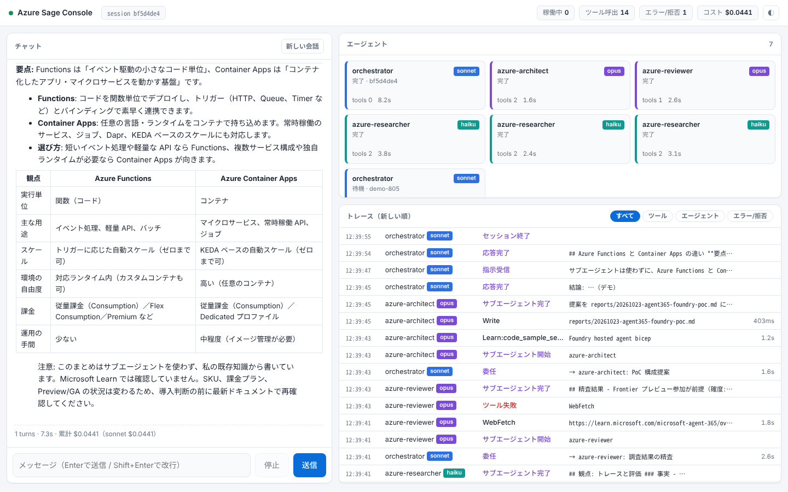

# Azure Sage — Claude Code で作る Azure 調査・開発提案エージェント

Azure 全般（Microsoft Foundry / Agent 365 とその周辺を含む）を、**調査は軽量モデル、精査と提案は Opus** で分担するマルチエージェント構成です。
ブラウザの **Agent Console** から、エージェントとのチャットと、動作中のトレースのリアルタイム表示ができます。



## 構成

```
        ブラウザ  http://127.0.0.1:4400
   ┌────────────────────────────────────────────────┐
   │ ポータル /   猫神さま管理 /admin   Agent Console /console │   web/（Next.js）
   └───────┬────────────────────────┬───────────────┘
      /api/* │                       │ /console-api/*, /console-events (SSE)
   ┌─────────▼──────────┐   ┌────────▼─────────────────────────────┐
   │ portal/backend     │   │ dashboard/server.mjs  (:4317)         │
   │ FastAPI (:4401)    │   │  ・Claude Agent SDK で会話を実行      │
   │  台帳・定義ファイル │   │  ・POST /hooks でフックイベントを受信 │◀── CLI の `claude` からも同じフックが届く
   │  テーマ・性格       │   └────────┬─────────────────────────────┘
   └────────────────────┘            │ settingSources: ['project']
        ┌────────────────────────────▼─────────────┐
        │ orchestrator (sonnet)  … CLAUDE.md        │
        │  ├─ azure-researcher (haiku) ×並列        │── Microsoft Learn MCP / Web
        │  ├─ azure-inventory  (haiku)              │── Azure MCP Server（読み取りのみ）
        │  ├─ azure-reviewer   (opus)  精査         │
        │  └─ azure-architect  (opus)  開発提案     │── reports/ に提案書を出力
        └──────────────────────────────────────────┘
```

| ファイル | 内容 |
|---|---|
| `CLAUDE.md` | 指揮役のルールとワークフロー（分解 → 並列調査 → 精査 → 提案） |
| `.claude/agents/<親の名前>/<名前>.md` | エージェント定義（Azure Sage の 4 つは `azure-sage/`）。`model:` でモデルを固定。ポータルのノードグラフから追加・編集できる（[ADR 0016](docs/adr/0016-agent-definition-files.md)） |
| `.mcp.json` | Microsoft Learn MCP（リモート）と Azure MCP Server（npx） |
| `.claude/settings.json` | 権限（読み取り中心、書き込みは reports/・research/ のみ、`az` の変更系は拒否）と HTTP フック |
| `knowledge/agent-platform-map.md` | Agent 365 / Foundry 周辺サービスの見取り図（調査の起点） |
| `dashboard/` | Agent Console のサーバー（Node.js。チャットの実行・フックの受信・SSE。API 専用） |
| `web/` | 画面（Next.js / React / TypeScript / Tailwind CSS / Radix UI）。ポータル・猫神さま管理・Agent Console |
| `portal/backend/` | ポータルの API（Python / FastAPI）。台帳・定義ファイル・テーマ・性格 |
| `scripts/demo-events.mjs` | API キーなしで画面を確認するデモイベント |

## 猫神さま（NekoGamiSama）— 上位オーケストレーター

Phase 2 で、全体を束ねる上位オーケストレーター「猫神さま」を追加しました。Azure Sage はその**サブオーケストレーター**として、これまでどおり動きます。

```
猫神さま (nekogamisama/)            … 振り分けと統合
 └─ azure-sage（サブオーケストレーター）  … 上の構成そのまま
      ├─ azure-researcher / azure-inventory / azure-reviewer / azure-architect
```

- 猫神さまと話す: ポータル（http://127.0.0.1:4400）の右のチャット（詳細は [nekogamisama/README.md](nekogamisama/README.md)）。
- 台帳（UUID・親子・Docker 起動停止）も同じポータルで扱います。
- トレースのエージェント発言には語尾「にゃ」が付きます（`NYA_SUFFIX=` で無効化）。
- ポータルと Agent Console の色（モード・アクセント色）は、管理ページの「🎨 テーマ」で設定します（[ADR 0025](docs/adr/0025-theme.md)）。
- ポータルのチャットでは `/名前 依頼文` で、委任先やエージェントを指名できます（[ADR 0026](docs/adr/0026-chatbot-agent-and-slash-commands.md)）。

## 前提

- **Node.js 20.9 以上**（画面と Agent Console）、**Python 3.10 以上**（ポータルの API）、Claude Code（`npm i -g @anthropic-ai/claude-code`）
- Claude の認証（`claude` でログイン済み、または `ANTHROPIC_API_KEY`。Agent Console の画面からもログインできます）
- Azure を見る場合: Azure CLI で `az login`。**閲覧者（Reader）ロールのアカウントを推奨**します。Azure MCP の操作権限は、そのアカウントの RBAC で決まります。

## セットアップと起動

```bash
# 1. Agent Console のサーバー（:4317）— Docker か、手元の Node のどちらか
docker compose up -d --build          # または: cd dashboard && npm install && npm start

# 2. ポータルの API（FastAPI :4401）と画面（Next.js :4400）
scripts/portal.sh                     # 初回は .venv の作成・依存の導入・ビルドも行う
# 開発するとき: scripts/portal.sh dev
```

ブラウザで **http://127.0.0.1:4400** を開きます（ポータル `/`、猫神さま管理 `/admin`、Agent Console `/console`）。
ポートは `PORTAL_PORT`（API、既定 4401）、`TRACE_PORT`（Console、既定 4317）で変えられます。Next.js の中継先は `PORTAL_API_URL`・`CONSOLE_URL` で変えられます（`web/next.config.mjs`）。

テスト: `cd portal/backend && ../../.venv/bin/python -m unittest discover -s tests`（API）、`node --test dashboard/*.test.mjs`（Console）、`cd web && npm test && npm run typecheck`（画面）。

### 使い方 A: ブラウザでチャット
`/console` のヘッダーの「相手」で、猫神さま・Azure Sage・猫神さまの委任先のサブオーケストレーター・各エージェントを選んで話せます（会話は相手ごとに別。[ADR 0020](docs/adr/0020-agent-console-multi-target.md)）。画面左で質問します。右側に、指揮役とサブエージェント（モデルのバッジ付き）の状態、ツール呼び出し、所要時間、エラー、許可の拒否がリアルタイムで流れます。行をクリックすると入出力が見られます。

### 使い方 B: いつもの Claude Code（CLI / VS Code）
```bash
cd nekogami
claude
```
フックはプロジェクト設定に入っているので、ダッシュボードを起動しておけば CLI の操作も同じ画面でトレースできます。初回は MCP サーバーとフォルダの信頼を承認してください。

> ダッシュボードを起動していないとフックの送信先に接続できず、フックのエラー表示が出ることがあります（動作は止まりません）。トレースが不要なときは `.claude/settings.local.json` で `"disableAllHooks": true` にしてください。

### デモ（API キーなしで画面だけ確認）
```bash
cd dashboard && npm start      # 別ターミナルで
npm run demo                   # 画面は http://127.0.0.1:4400/console
```

## カスタマイズ

- **モデル配分**: `.claude/agents/*.md` の `model:`（`haiku` / `sonnet` / `opus` / フルモデル ID）。指揮役は `.claude/settings.json` の `model`、またはチャット用に環境変数 `CHAT_MODEL=opus`。
- **Azure MCP を使わない**: `.mcp.json` から `azure` を削除するか、チャットでは `ALLOW_AZURE_MCP=0 npm start`。
- **専門エージェントを追加**: ポータルの「猫神さま管理」のノードグラフで追加するか、`.claude/agents/<親の名前>/<名前>.md` を手で置きます（例: コスト見積り担当、Bicep レビュー担当）。手で置いた定義は、ポータルの「組み込みを取り込み」で台帳に入ります。
- **ポート**: `TRACE_PORT`（変える場合は `.claude/settings.json` のフック URL と、`CONSOLE_URL` も変更）。

## 安全設計

- チャットモードの許可は `server.mjs` の `canUseTool` で判定します。読み取り系、Learn MCP、Azure MCP は許可。Write/Edit は `reports/`・`research/` のみ許可。Bash などその他は拒否し、トレースに「拒否」として表示します。
- CLI では `.claude/settings.json` の allow/deny が効きます。`az` の作成・削除・更新系はあらかじめ拒否しています。
- 3 つのサーバーはすべて `127.0.0.1` だけで待ち受けます。Host / Origin を検査し（DNS リバインディング対策）、ポータルの API は `PORTAL_TOKEN` で Bearer 認証もできます。WSL2 で動かして Mac など別 PC のブラウザから見るときは `scripts/portal.sh lan`（画面だけ 0.0.0.0 で公開。API は 127.0.0.1 のまま）。Windows 側のファイアウォール（Mirrored では Hyper-V ファイアウォール）で 4400 の受信許可も要ります。社内で共有する場合は、認証付きのリバースプロキシを前に置き、`PORTAL_ALLOWED_HOSTS` に公開ホスト名を入れてください。
- 回答中の HTML / SVG は、通信・外部読み込みを禁止したサンドボックスの iframe にだけ表示します。

## 次の一手（任意）

- トレースを Application Insights（OpenTelemetry）にも送れば、Foundry のエージェントと同じ場所で可観測性をそろえられます。
- 同じ役割分担は Foundry Agent Service でも組めます。Claude Code 版で運用を固めてから、Foundry/Agent 365 側へ移すと比較検証になります。

## ライセンス

本体は MIT（[LICENSE](LICENSE)）。依存パッケージの許諾は [docs/licenses/](docs/licenses/README.md)、Claude など有料・独自条件のものは [NOTICE.md](NOTICE.md) を参照してください。
